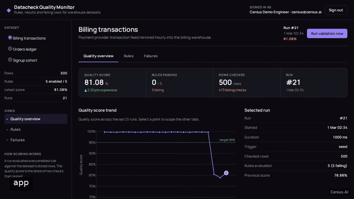
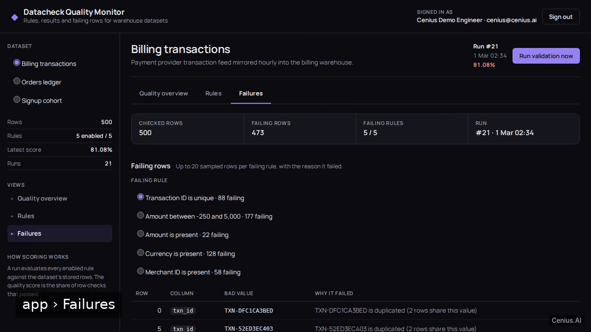

# Datacheck Quality Monitor — complete Full-stack app monitoring dashboard example app

Clone it. Run it. Own it. **Datacheck Quality Monitor** is a complete, Apache-2.0-licensed monitoring dashboard in Full-stack app — full source, demo data included. Datacheck Quality Monitor is a Plotly Dash web app that gives data engineers the results dashboard their Great Expectations runs never had: declare validation rules (null checks, ranges, uniqueness) on a dataset, run…. Self-host Datacheck Quality Monitor on your own infrastructure, or open it on [cenius.ai](https://cenius.ai/marketplace/p/datacheck-quality-monitor?ref=gh&utm_campaign=datacheck-quality-monitor-webapp) to request changes and get a Datacheck Quality Monitor fresh build.


[](LICENSE)  [](https://cenius.ai)

[](https://cenius.ai/marketplace/p/datacheck-quality-monitor?ref=gh&utm_campaign=datacheck-quality-monitor-webapp)

> **▶ [Open & edit in cenius.ai](https://cenius.ai/marketplace/p/datacheck-quality-monitor?ref=gh&utm_campaign=datacheck-quality-monitor-webapp)** — one click to an editable workspace: describe changes in plain English, get an instant preview, one-click deploy and host. Modifications made on the platform come with full rebrand & relicense rights.

_Local clone? See [Quick start](#quick-start) below. cenius.ai is the zero-setup path._

## Demo



▶ **[Watch the full demo video](https://cenius.ai/marketplace/p/datacheck-quality-monitor?ref=gh&utm_campaign=datacheck-quality-monitor-webapp)** — the complete walkthrough, playing on the project's cenius.ai page · [MP4 file](.github/media/demo.mp4)

## Screenshots

  

## Quick start

```bash
./install.sh   # installs dependencies + seeds demo data
```

See [`INSTALL.md`](INSTALL.md) for full setup and usage instructions.

## Architecture

`install.sh` wires up dependencies and loads seed records; after it runs the app has real data to show. The Full-stack app codebase (78 files) is self-contained — no external services needed to evaluate it. Top-level layout: `datacheck/`, `docs/`, `tests/`. Full setup details: [`INSTALL.md`](INSTALL.md).

## Features

- Demo sign-in and session gate
- Three-tab workspace shell with dataset selector
- Validation rules on datasets (nulls, ranges, uniqueness)
- Rule pass/fail history per dataset
- Failing rows sample viewer
- Quality score trend
- Seeded demo workspace

## Usage guide

### Overview

An open-source Plotly Dash dashboard for dataset validation rules, rule history and failing-row samples.

### Quickstart

After completing the install steps in `INSTALL.md`:

```bash
flask --app app run --debug    # start the server
## in another terminal:
curl http://localhost:8000/health
```

### Endpoints

Every endpoint below was extracted from the source by the route scanner (Next.js / FastAPI / Flask / Django / Express).

| Method | Path | Source file |
|--------|------|-------------|
| `GET` | `/health` | `datacheck/main.py` |
| `GET` | `/login` | `datacheck/main.py` |
| `POST` | `/signout` | `datacheck/main.py` |

#### curl examples

##### `GET /health`

```bash
curl http://localhost:8000/health
```

##### `GET /login`

```bash
curl http://localhost:8000/login
```

##### `POST /signout`

```bash
curl -X POST http://localhost:8000/signout \
     -H 'Content-Type: application/json' \
     -d '{"field": "value"}'
```

### Worked example

1. Boot the server (`flask --app app run --debug`).
2. Hit a smoke-test endpoint:

```bash
curl -sS http://localhost:8000/health
```

3. If you get a JSON / HTML response, the server is healthy. Inspect `.env` if it errors with an auth/config failure.

### Reference

#### Entry points

_No explicit entry points declared in this project's manifests._

#### Surface index (auto-extracted)

| Kind | Title | Source file |
|------|-------|-------------|
| route | `GET /health` | `datacheck/main.py` |
| route | `GET /login` | `datacheck/main.py` |
| route | `POST /signout` | `datacheck/main.py` |

### Next steps

_Full guide: [`USAGE.md`](USAGE.md)_

## FAQ

### What does it take to self-host Datacheck Quality Monitor?

Pull the repo, run `./install.sh`, and you are up — the script installs packages and pre-seeds the database. [`INSTALL.md`](INSTALL.md) covers any platform-specific tweaks.

### What powers Datacheck Quality Monitor under the hood?

Datacheck Quality Monitor runs on Full-stack app. This repo holds the full production source: you can inspect every part of it before deploying. Highlights include seeded demo workspace.

### How can I customize Datacheck Quality Monitor without editing code?

Open it on [cenius.ai](https://cenius.ai/marketplace/p/datacheck-quality-monitor?ref=gh&utm_campaign=datacheck-quality-monitor-webapp) and describe the changes you want in plain English — the platform modifies the app and gives you a new, downloadable build.

### Can I rebrand or white-label Datacheck Quality Monitor?

White-labeling is supported: fork the MIT-licensed source and rebrand it yourself, or use [cenius.ai](https://cenius.ai/marketplace/p/datacheck-quality-monitor?ref=gh&utm_campaign=datacheck-quality-monitor-webapp) to make changes in a guided workspace — platform modifications come with full rebrand rights.

### What license does Datacheck Quality Monitor use?

The code is under the Apache-2.0 license, which allows commercial use without restriction. You can build, sell, and deploy it freely. Full text: [LICENSE](LICENSE).

## License & rebranding

Released under the [Apache License 2.0](LICENSE) (© 2026 Cenius AI) — free for personal and commercial use. The Cenius name/logo are trademarks (see NOTICE).

**Need a customized version?** [Remix this app on cenius.ai](https://cenius.ai/marketplace/p/datacheck-quality-monitor?ref=gh&utm_campaign=datacheck-quality-monitor-webapp) — modifications made on the platform come with **full rebrand & relicense rights** over your derivative.

## Built with cenius.ai

This entire application — code, design, seeded demo data — was generated on **[cenius.ai](https://cenius.ai)** from a plain-English description.

- 🚀 [Build your own app on cenius.ai](https://cenius.ai)
- 🎛️ [Remix Datacheck Quality Monitor on the marketplace](https://cenius.ai/marketplace/p/datacheck-quality-monitor?ref=gh&utm_campaign=datacheck-quality-monitor-webapp) — open it in a workspace, prompt for changes, and ship your own version.

More open-source apps: [the Cenius-ai catalog](https://github.com/Cenius-ai) · [showcase index](https://github.com/Cenius-ai/showcase)
